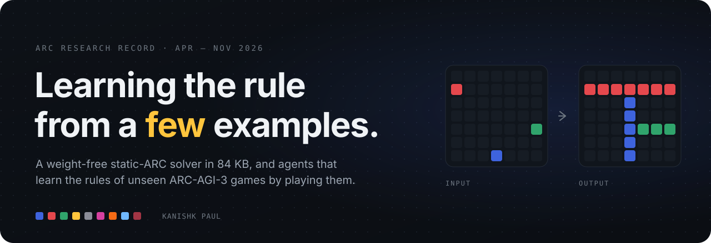
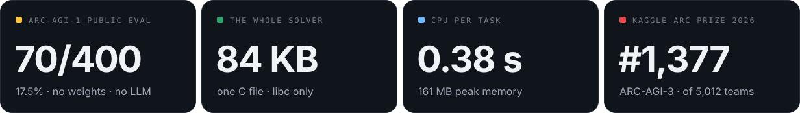
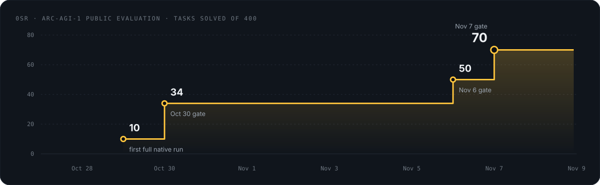
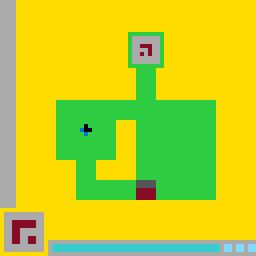
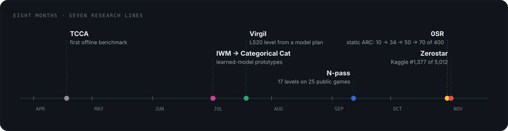

<p align="center">
  
</p>

<p align="center">
  <a href="#0sr--70-of-400-from-84-kb"><b>0SR</b></a>&nbsp;&nbsp;·&nbsp;&nbsp;<a href="#arc-agi-3--learning-games-by-playing-them"><b>ARC-AGI-3</b></a>&nbsp;&nbsp;·&nbsp;&nbsp;<a href="#eight-months"><b>Timeline</b></a>&nbsp;&nbsp;·&nbsp;&nbsp;<a href="docs/rigour.md"><b>Rigour</b></a>&nbsp;&nbsp;·&nbsp;&nbsp;<a href="docs/README.md"><b>Full record</b></a>
</p>

<p align="center">
  <a href="https://github.com/kanishkpaul/arc-agi3-world-models/actions/workflows/ci.yml"></a>
  <a href="scripts/verify_results.py"></a>
  <a href="LICENSE"></a>
  <a href="pyproject.toml"></a>
</p>

<br>

<p align="center">
  
</p>

ARC asks a system to infer a rule from a handful of examples, or, in ARC-AGI-3, to learn an unfamiliar game by playing it. Between April and November 2026 I built seven research systems against it. This repository is their public record: the results, the conditions they were measured under, and the evidence that the numbers are what they say.

**The methods are private until the papers are out.** Everything here is an outcome you can check, not a recipe.

<br>

## 0SR — 70 of 400, from 84 KB

<p align="center">
  
</p>
<p align="center"><sub>Live and unedited: 0SR solving public evaluation tasks. <a href="assets/0sr/0sr-live.mp4">Full-resolution MP4</a>.</sub></p>

0SR solves **70 of the 400 ARC-AGI-1 public evaluation tasks** with no pretrained weights, no language model and no network. The whole solver is one C file, built as an **84 KB binary** that links only libc. It takes **0.38 s of CPU per task**.

| Measure | Result |
| :--- | :--- |
| ARC-AGI-1 public evaluation | **70 / 400** · 17.5% · 95% CI 14.1–21.5% |
| Last gate, against the unchanged control | **+20 tasks, 0 lost** · McNemar p = 1.9 × 10⁻⁶ |
| C port against its reference | **0 differences** in 6,240 paired task runs |
| Solver | 93 KB source · 84 KB binary · 161 MB peak memory |

<p align="center">
  
</p>

<sub>The public evaluation set was inspected during earlier development, so 70/400 is descriptive, not a held-out estimate. ARC-AGI-2: 0 of the 113 tasks it does not share with ARC-AGI-1. Nothing has been scored on hidden sets yet. → <a href="docs/results/0sr.md">Full 0SR card</a></sub>

<br>

## ARC-AGI-3 — learning games by playing them

ARC-AGI-3 drops an agent into turn-based games with no instructions. It has to discover the controls, the rules and the goal, then win efficiently. Scores measure **action efficiency against human players**, not the share of games solved.

<table>
  <tr>
    <td width="66%" valign="top">

| Milestone | Result |
| :--- | :--- |
| **Kaggle ARC Prize 2026**<br><sub>hidden games · Zerostar</sub> | **28.40** · rank **1,377 of 5,012** |
| **Best single pass, 25 public games**<br><sub>Zerostar · configuration C</sub> | **49.50%** · 106 of 183 levels · 7 games won |
| **A level from a model plan**<br><sub>Virgil · LS20</sub> | Level 1 in **76 actions**, replayable |
| **Exact reproduction**<br><sub>Virgil CX · frozen commits</sub> | 2.23% and 0.56% reproduced to the digit |

</td>
    <td width="34%" valign="top" align="center">
      <br>
      <sub>Virgil completing LS20 level 1. <a href="docs/virgil-result-card.md">Replay it yourself →</a></sub>
    </td>
  </tr>
</table>

<sub>Zerostar was built on a public community baseline notebook. Public-game and hidden-game scores answer different questions: the configuration that scored 49.50% on the public games scored 6.15 on the leaderboard. → <a href="docs/results/kaggle.md">Leaderboard record</a> · <a href="docs/results/arc-agi-3-public25.md">Every public-game run</a></sub>

<br>

## Eight months

<p align="center">
  
</p>

Each line was a separate bet, recorded with its outcome whether it worked or not. → <a href="docs/history.md">Dated history</a>

<br>

## How the numbers are kept honest

- **Pre-registered.** Each experiment states its arms, metric, promotion rule and kill rule before it runs. Directions that miss are killed, and their numbers are kept.
- **Gated.** Public evaluation sets are scored only at milestone gates. A change is promoted only if it gains on development, loses nothing on validation, and holds on fresh instances.
- **Replicated.** Headline runs are repeated, ports are checked answer for answer, and local scores are matched to the official scorer.
- **Checkable.** Every aggregate here comes from a published table. The tables are recomputed in CI, and the figures above are generated from them.

→ <a href="docs/rigour.md">How results are kept honest</a> · <a href="docs/evaluation.md">Evaluation guide</a> · <a href="docs/public-scope.md">Public scope</a>

<br>

## Papers in preparation

- A weight-free static-ARC solver under 100 KB
- What limits agents on interactive ARC-AGI-3 games, measured against human play
- Evaluating world models learned from interaction

Methods, analyses and code will appear with the papers.

<br>

<details>
<summary><b>Run the checks and the public library</b></summary>
<br>

Requires Python 3.11+ and NumPy. No API key and no GPU.

```bash
python3 -m venv .venv
source .venv/bin/activate
pip install -e ".[dev]"

pytest -q                         # library, evidence-integrity and table checks
python scripts/verify_results.py  # recompute every published aggregate
python examples/verify_demo.py    # offline replay evaluation of world models
python scripts/make_figures.py    # regenerate the README figures from the records
```

`arc3_substrate` is a small offline library for ARC-AGI-3: grid perception, transition logging, a `WorldModel` prediction protocol and a replay evaluator. The example scores an identity baseline against a recorded-answer oracle. The oracle exists to validate the evaluator; it is not an induced model.

The LS20 replay is a separate online check against the official environment:

```bash
pip install arc-agi==0.9.9
python evidence/virgil-ls20-v1/replay_trace.py
```

</details>

<details>
<summary><b>Repository guide</b></summary>
<br>

```text
arc3_substrate/   Offline perception, logging and replay evaluation
assets/           Figures (generated) and the 0SR video
docs/             Result cards, rigour, evaluation guide, history, public scope
evidence/         Sanitized tables and records: results-v1, results-v2, LS20 trace
examples/         Offline demonstration
scripts/          Table verification, figure generation, installed-wheel check
tests/            Library, evidence-integrity and result-table checks
```

</details>

<br>

<p align="center">
  <b>Kanishk Paul</b><br>
  <a href="https://kanishkpaul.com/research">Research</a> · <a href="https://github.com/kanishkpaul">GitHub</a><br>
  <sub>Code is MIT-licensed. Cite via <a href="CITATION.cff"><code>CITATION.cff</code></a>.</sub>
</p>
