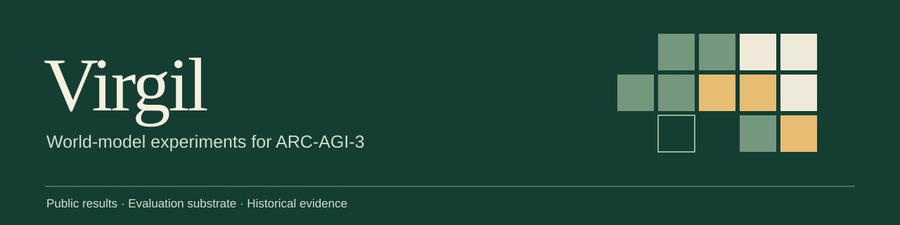
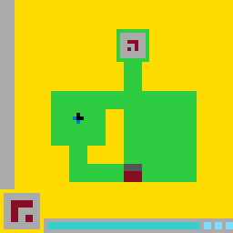

<p align="center">
  
</p>

<p align="center">
  <a href="https://github.com/kanishkpaul/arc-agi3-world-models/actions/workflows/ci.yml"></a>
  <a href="LICENSE"></a>
  <a href="pyproject.toml"></a>
</p>

<p align="center">
  <a href="#results">Results</a> ·
  <a href="docs/README.md">Research record</a> ·
  <a href="#run-the-public-library">Run the library</a> ·
  <a href="docs/public-scope.md">Public scope</a>
</p>

# ARC-AGI-3 World Models

**The public results and evaluation companion to Virgil.**

How can an agent learn an unfamiliar game's rules from interaction and use a world model to choose its next move? TCCA, IWM, Categorical Cat, and Virgil explored that question through several research prototypes.

This repository publishes their measured outcomes, evaluation conditions, and a small runnable library for perception, transition logging, and replay evaluation. The full solver implementations remain private.

> **Status · October 13, 2026**  
> Virgil development is resuming. The results below are dated historical snapshots, with limited game completion. This update reports existing experiments; it does not announce a new solver result.

## Results

Each score is an **action-efficiency percentage**, not the percentage of games solved. The experiments differ in implementation, budget, and replay/reset protocol; they are not a controlled leaderboard comparison.

| Experiment | Recorded outcome | Evaluation |
| :--- | :--- | :--- |
| [TCCA](docs/results/prototypes.md#tcca) | **0.2567%** · 4 / 183 levels | Offline benchmark, 25 public games |
| [IWM](docs/results/prototypes.md#iwm) | **0 levels** · score not finalized | Interrupted API run, 4 games touched |
| [Categorical Cat](docs/results/prototypes.md#categorical-cat) | **0.0%** · 0 levels | Online run, stopped after 11 environments |
| [Virgil CC · LS20](docs/virgil-result-card.md) | **1 level in 76 actions** | One game; hand-authored model |
| [Virgil CX · regression](docs/results/virgil-cx.md#research-regression) | **2.23268%** · 16 levels | Exploration and fresh replay, 25 games |
| [Virgil CX · competition-style](docs/results/virgil-cx.md#competition-style-public-run) | **0.56164%** · 17 levels | Notebook artifact, restricted reset semantics |
| [Virgil · N-pass](docs/results/npass.md) | **1.44495%** · 17 / 183 levels | Per-game maximum across discovery and replay |

The N-pass run won **zero full games**. Its discovery-only score was **0.57673%**; replay-only was **1.34157%**. The maximum selects each game's better play rather than describing one single pass.

Read the [evaluation guide](docs/evaluation.md) before comparing these numbers. Sanitized tables and summaries are in [`evidence/results-v1/`](evidence/results-v1/); the underlying solver runs are not publicly reproducible from this repository.

## A replayable result

The existing LS20 record preserves a concrete first-level completion: **60 survey actions, then 16 actions recorded as originating from a model plan**. The level counter advanced on action 76.

<p align="center">
  
</p>

The model was **hand-authored from recorded interaction evidence**. This supports one model-based planning demonstration, not autonomous induction or cross-game generalization. The public trace verifies the action sequence and observations; it cannot independently prove how the private implementation generated the plan.

[Read the result card →](docs/virgil-result-card.md)

## Run the public library

The library runs offline with Python 3.11+ and NumPy. No API key or GPU is needed for the tests or example.

```bash
python3 -m venv .venv
source .venv/bin/activate
pip install -e ".[dev]"

pytest -q
python examples/verify_demo.py
python scripts/verify_results.py
```

The example compares an identity baseline with a recorded-answer Oracle. The Oracle validates the evaluator by returning known answers; it is not an induced model. The result script checks the arithmetic of the published historical tables, without running a solver.

The LS20 replay is a separate **online** command:

```bash
pip install arc-agi==0.9.9
python evidence/virgil-ls20-v1/replay_trace.py
```

It opens an anonymous scorecard, downloads the public environment, and checks the recorded frame hashes and level transition. It does not reconstruct the private model or planner.

## Repository guide

```text
arc3_substrate/   Offline perception, logging, and replay evaluation
assets/          README artwork
docs/            Result cards, evaluation notes, history, public scope
evidence/        Existing LS20 record and sanitized result tables
examples/        Small offline demonstration
scripts/         Published-table and installed-wheel checks
tests/           Library, evidence-integrity, and result-table checks
```

The full agents, generated models, planners, prompts, solution banks, and current research plans remain private during active development. This repository makes no commitment to release them. See [public scope](docs/public-scope.md) for the evidence boundary.

---

Kanishk Paul · [Research](https://kanishkpaul.com/research) · [GitHub](https://github.com/kanishkpaul)  
Code licensed under [MIT](LICENSE). Citation metadata: [`CITATION.cff`](CITATION.cff).
