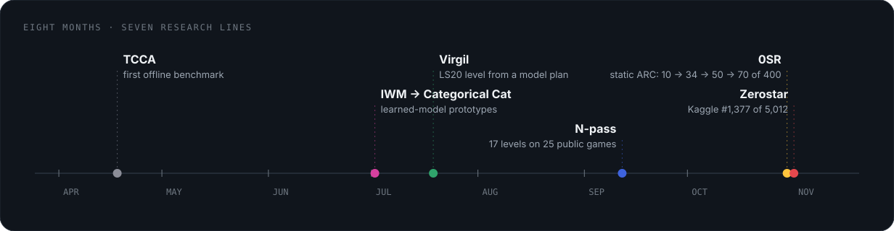

# A short history

[← Research record](README.md)

| Date | Record |
| :--- | :--- |
| April 2026 | TCCA offline public-game benchmark: four completed levels |
| June 2026 | IWM API attempt stopped without a completed level or finalized score |
| July 2026 | Categorical Cat online attempt and offline diagnostic work |
| July 13, 2026 | Virgil CC Kaggle submissions: leaderboard 0.21 |
| July 19, 2026 | Virgil LS20 demonstration captured; Virgil CX public evaluations |
| September 2026 | N-pass result; original solver lines retired and archived |
| September 24, 2026 | Virgil CX evaluations reproduced exactly from frozen commits |
| October 13, 2026 | Public results record first refreshed |
| October 18–22, 2026 | Zerostar: audit of the earlier lines and a literature review |
| October 28–31, 2026 | Static ARC work begins; 10 → 34 of 400 ARC-AGI-1 public evaluation tasks |
| October 31 – November 3, 2026 | Zerostar ARC Prize 2026 Kaggle entries; best leaderboard score 28.40, rank 1,377 of 5,012 |
| November 2, 2026 | Static ARC work becomes its own program, 0SR |
| November 7, 2026 | 0SR reaches 70 of 400 on ARC-AGI-1; solver ported to a single 84 KB C binary |
| November 10, 2026 | This record updated with results through November |

The dates separate when an experiment ran from when this documentation was updated. Organisational changes and documentation updates are not new performance results.

TCCA, IWM, Categorical Cat, Virgil, Zerostar and 0SR are related research lines, not versions of one consistently evaluated solver.
