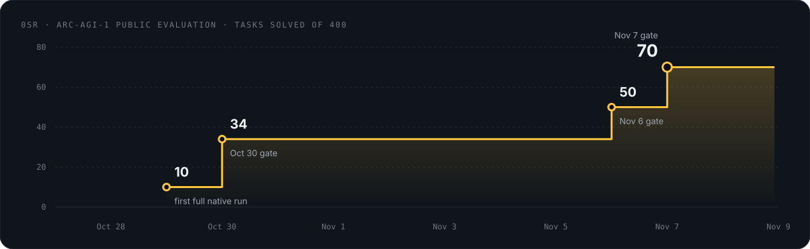

# 0SR · static ARC from 84 KB

[← Research record](../README.md) · [Evaluation guide](../evaluation.md)

  

Live and unedited: 0SR solving public evaluation tasks. <a href="../../assets/0sr/0sr-live.mp4">Full-resolution video (MP4)</a>.

## Claim

0SR solves **70 of the 400** ARC-AGI-1 public evaluation tasks (17.5%). It has no pretrained weights, no language model, and no network access. The whole scoring program is a single C file that compiles to an **84,032-byte** binary using only libc. It averages **0.38 s** of CPU per task with a peak of 161 MB of memory.

| Measurement | Value |
| :--- | ---: |
| ARC-AGI-1 public evaluation | **70 / 400** (17.5%; 95% CI 14.1–21.5%) |
| ARC-AGI-1 strict count (one task duplicates a development task) | 69 / 399 |
| ARC-AGI-2 public evaluation, tasks shared with ARC-AGI-1 removed | 0 / 113 |
| Solver source / binary | 93,269 B / 84,032 B |
| CPU per task, mean (max) | 0.376 s (3.84 s) |
| Peak memory | 161 MB |
| Pretrained weights · LLM calls · network | none · none · none |

## How it got here

Each gain had to be promoted through a pre-registered gate before it was allowed near the public set:

- an improvement on a development split;
- **zero losses** on a frozen validation split;
- confirmation on freshly generated task instances.

The final gate added **+20 tasks with zero losses** against the unchanged control (exact McNemar p = 1.9 × 10⁻⁶). The result was identical across three independent runs.

## Engineering checks

- **Port fidelity.** The C program reproduces the reference implementation exactly. Across 6,240 paired task runs there were **0 differences** in submitted answers, candidates or scores.
- **Stability.** 12,480 task runs produced 0 errors, 0 hard timeouts and 0 divergences, and every trace reconstructs.
- **Memory safety.** Bounds checks are on in every build. AddressSanitizer, UndefinedBehaviorSanitizer and a fuzz harness run in `make check`, and untrusted input runs sandboxed.
- **Efficiency.** Compared with the reference implementation on the same tasks, the C program uses 30–43× less CPU.

## Scope and limits

- **Descriptive only.** The ARC-AGI-1 public evaluation set had been inspected during earlier development, so 70/400 describes performance on a known set. It is not a held-out estimate. Nothing has been scored on the semi-private or private sets.
- **ARC-AGI-2.** Seven ARC-AGI-2 public evaluation tasks also appear in ARC-AGI-1. The one ARC-AGI-2 task 0SR solves, shown at the end of the video, is one of those seven. On the 113 tasks that are unique to ARC-AGI-2, it solves none.
- **Private.** The method, source and per-task results are private while the paper is in preparation.

Aggregate measurements are in [`records.json`](../../evidence/results-v2/records.json) and are checked by `scripts/verify_results.py`.
